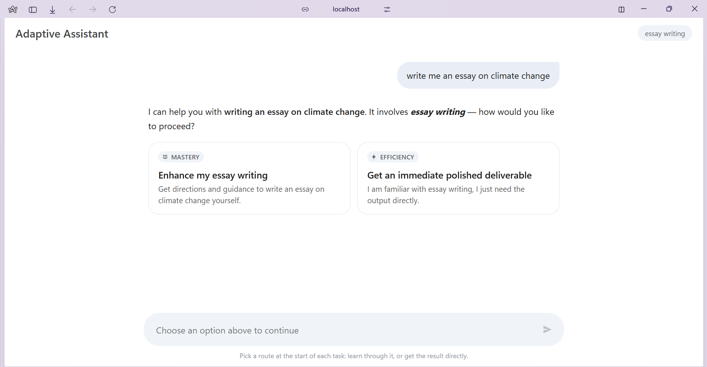
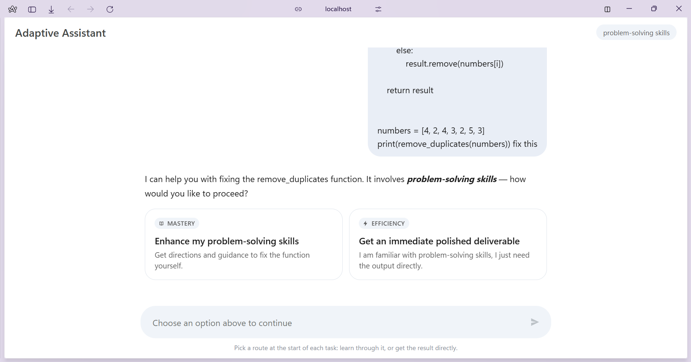
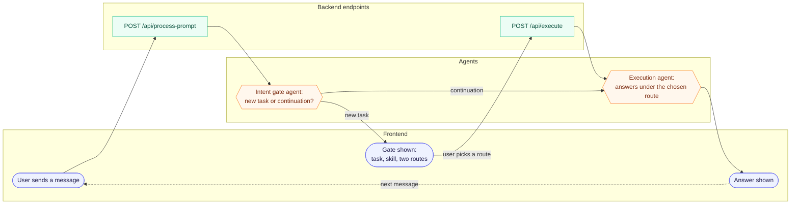

# Intent Clarification Gate

An LLM chat interface that asks, at the start of every new task, how you want to be helped: **learn through it** (Mastery: step-by-step coaching) or **get the result directly** (Efficiency: the finished deliverable). The choice holds for the whole task and resets when a new one starts.

| Writing task | Coding task |
|---|---|
|  |  |

## Contents

- [Problem](#problem)
- [Goal](#goal)
- [Solution](#solution)
- [How it works](#how-it-works)
- [Tech stack](#tech-stack)
- [Project structure](#project-structure)
- [Getting started](#getting-started)
- [Configuration](#configuration)


## Problem

When people are tired, lose track of their goal, or don't know how to phrase a request, they fall back on delegative-style commands like "fix this". AI tools take these literally and hand over a finished answer, even when the person actually wanted to learn. Over time this means offloading the thinking, losing the skill, and depending on the tool.

## Goal

Make users notice how they are using the AI and what they really want from it, and nudge them to work *with* it (AI as partner) rather than just hand the task over (AI as doer), without ever taking the choice away from them.

## Solution

At the start of each new task, the system holds back its answer, names the skill the user is about to offload, and offers a choice between two routes:

- **Mastery**: work through the task together. The assistant sets the goal, breaks it into steps and coaches one step at a time, staying on a step until the attempt is right. Asking twice to skip still gets the full answer.
- **Efficiency**: a conscious hand-off. The finished result comes first, then a short explanation.

The choice holds for the whole task. Follow-ups and answers to a step continue on the same route; a new task opens a new gate.


## How it works




| Endpoint | Purpose |
|---|---|
| `POST /api/process-prompt` | Every user message. Returns either a gate (`needs_gate: true`, the task, the skill and both routes) or an answer under the active mode. |
| `POST /api/execute` | The user's route choice. Locks the mode and returns the first answer of the task. |
| `GET /health` | Liveness check. |


## Tech stack

| Layer | Tools |
|---|---|
| Backend | Python, FastAPI, OpenAI Python SDK, Pydantic, pydantic-settings |
| Frontend | React 19, TypeScript, Vite|
| Models | `gpt-4o-mini` for the gate, `gpt-4o` for answers (both configurable) |

## Project structure

```
backend/
  app/
    main.py              # app setup: logging, error handlers, CORS, router
    config.py            # settings from .env, the single OpenAI client factory
    api/
      endpoints.py       # the two routes, thin: validate, call the agents, return
      error_handling.py  # exceptions -> {code, detail} responses
    agents/
      intent_gate.py     # new task or continuation? (structured output)
      execution.py       # answers under the chosen route
      orchestrator.py    # gate or answer, for each message
    prompts/             # one system prompt per agent
    schemas/
      api_payloads.py    # request/response models (the API contract)
      llms_outputs.py    # what the gate model fills
    utils/timing.py      # logs how long each agent call takes
  requirements.txt
  .env.example
frontend/
  src/
    App.tsx              # chat state, thread and composer
    api.ts               # the API client
    types.ts             # mirrors the backend contract
    components/          # IntentGate, Markdown, Icons
```

## Getting started

You will run two programs side by side, each in its own terminal: the **backend** (Python API) and the **frontend** (web interface).

### Prerequisites

- **Python 3.14** (the version used in development), installed directly or through [Miniconda/Anaconda](https://docs.anaconda.com/miniconda/)
- **Node.js 24** and npm ([nodejs.org](https://nodejs.org))
- An **OpenAI API key** ([platform.openai.com](https://platform.openai.com/api-keys))

Clone the repository:

```bash
git clone https://github.com/lynn1404/Intent-Clarification.git
cd Intent-Clarification
```

### 1. Backend

All commands in this section run from the `backend/` folder:

```bash
cd backend
```

#### 1.1 Create and activate a Python environment

Pick **one** option, conda or venv.

**Option A: conda** (same commands on every OS)

```bash
conda create -n intent-clarification python=3.14
conda activate intent-clarification
```

**Option B: venv** (built into Python)

Create the environment:

| OS | Command |
|---|---|
| Windows | `python -m venv .venv` |
| macOS / Linux | `python3 -m venv .venv` |

Activate it:

| OS / shell | Command |
|---|---|
| Windows (PowerShell) | `.venv\Scripts\Activate.ps1` |
| Windows (Command Prompt) | `.venv\Scripts\activate.bat` |
| macOS / Linux | `source .venv/bin/activate` |

Once it is active, the environment name, `(intent-clarification)` or `(.venv)`, appears at the start of your prompt.

#### 1.2 Install the dependencies

```bash
pip install -r requirements.txt
```

#### 1.3 Add your OpenAI key

Copy the example settings file:

| OS / shell | Command |
|---|---|
| Windows (PowerShell) | `Copy-Item .env.example .env` |
| Windows (Command Prompt) | `copy .env.example .env` |
| macOS / Linux | `cp .env.example .env` |

Open `backend/.env` and replace the placeholder with your key:

```
OPENAI_API_KEY=sk-...
```

`.env` is ignored by git, so your key is never committed.

#### 1.4 Start the API

```bash
uvicorn app.main:app --reload
```

Check it is running: http://localhost:8000/health returns `{"status": "ok"}`, and http://localhost:8000/docs shows the interactive API documentation.

Keep this terminal open. Next time, you only need to activate the environment (step 1.1) and start the API (step 1.4).

### 2. Frontend

In a **second terminal**, from the repository root:

```bash
cd frontend
npm install
npm run dev
```

Open http://localhost:5173. The Vite dev server forwards every `/api` request to the backend on port 8000, so no configuration is needed.


Next time, `npm run dev` is enough.

### Troubleshooting

| Symptom | Cause and fix |
|---|---|
| The backend fails at startup with `OPENAI_API_KEY` / `Field required` | No `.env`, or the key is missing from it. Create `backend/.env` from `.env.example` (step 1.3). |
| The UI shows "Cannot reach the server" | The backend is not running, or not on port 8000. Start it (step 1.4) and check `/health`. |
| The UI shows "The AI service is not configured correctly." | OpenAI rejected the key. Check `OPENAI_API_KEY` in `backend/.env` and restart the backend. |
| The UI shows "The AI service is busy" | OpenAI rate limit. Wait a few seconds and resend. |

## Configuration

All settings are read from `backend/.env`.

| Variable | Default | Purpose |
|---|---|---|
| `OPENAI_API_KEY` | required | Your OpenAI API key. |
| `GATE_MODEL` | `gpt-4o-mini` | The model that decides between a new task and a continuation. |
| `EXECUTION_MODEL` | `gpt-4o` | The model that writes the answers. |
| `LLM_TIMEOUT_S` | `60` | Timeout per OpenAI call, in seconds. |
| `MAX_RETRIES` | `2` | Retries on network errors and rate limits. |
| `ALLOWED_ORIGINS` | `http://localhost:5173,http://127.0.0.1:5173` | Comma-separated origins allowed to call the API directly. |
